<div align="center">

<picture>
  <source media="(prefers-color-scheme: dark)" srcset=".github/assets/banner-dark.svg">
  
</picture>

**Ring like a phone call, even while PHP is suspended.**<br>
System call surfaces for PAM Native: CallStyle and CallKit incoming calls, a lock-screen call UI, an ongoing-call foreground service, a durable action queue and push-driven ringing.

[](https://packagist.org/packages/pushinbr/pam-native-calls)

[](LICENSE)

[Install](#install) · [Quick example](#quick-example) · [Platforms](#platform-support) · [Permissions](#requirements) · [Docs](#docs) · [Issues](https://github.com/push-in/pam-native-calls/issues)

</div>

<a id="install"></a>
## <picture></picture> Install

Inside a PAM Native project, add only this capability:

```sh
pam composer require pushinbr/pam-native-calls
pam doctor --fix
```

The package is a PAM Native plugin (`extra.pam-native.plugin`). The build discovers it from Composer and generates the native integration; there is no `pam-native.json` entry to add. New to PAM? Create a project with `pam init my-app --template native` (see the [PAM Native overview](https://push-in.github.io/pam-docs/native/overview/)), then come back here.

<a id="quick-example"></a>
## <picture></picture> Quick example

```php
<?php

use Pam\Native\Calls\{CallAction, CallActionKind, Calls, IncomingCall};

// Once at boot (index.php or your root component's boot()).
Calls::onAction(function (CallAction $action): void {
    if ($action->kind === CallActionKind::Accept) {
        // Open your call screen and join $action->callId.
    }
});

// Ring now (for example from a foreground realtime event).
Calls::incoming(
    IncomingCall::make('call-42')->caller('Ana', 'https://cdn.example.com/ana.jpg')->video(),
)->show();
```

Incoming calls, actions, ongoing calls, ringing from push, the iOS VoIP token, readiness, WebRTC and the Zé Chat integration are in the [guide](docs/guide.md); every class and error is in the [API reference](docs/api-reference.md). A runnable minimal app is in [`example/`](example).

<a id="platform-support"></a>
## <picture></picture> Platform support

| Platform | Support | Notes |
| --- | --- | --- |
| Android | API 26+ | `Notification.CallStyle` on API 31+, full-screen intent, `camera\|microphone` foreground service |
| iOS | 15.0+ | CallKit, PushKit, AVFoundation; not validated on a device yet |
| PAM Native | 1.0.35 to < 2.0.0 | From `pam-native.plugin.json`; PHP 8.5+ |

<a id="requirements"></a>
## <picture></picture> Permissions and requirements

| Platform | Declared by the plugin |
| --- | --- |
| Android | `POST_NOTIFICATIONS`, `USE_FULL_SCREEN_INTENT`, `FOREGROUND_SERVICE`, `FOREGROUND_SERVICE_CAMERA`, `FOREGROUND_SERVICE_MICROPHONE`, `CAMERA`, `RECORD_AUDIO`, `VIBRATE`, `WAKE_LOCK`, `INTERNET` |
| iOS | `UIBackgroundModes`: `voip`, `audio`, `remote-notification`; entitlement `aps-environment` |

- Request `CAMERA` and `RECORD_AUDIO` at runtime before `Calls::ongoing()->show()`.
- `USE_FULL_SCREEN_INTENT`: Android 14+ grants it only to calling/alarm apps, and it must be declared in the Play Console as a calling app permission.
- Push-driven ringing on Android uses **FCM data messages** from the PAM Native core push stack (`google-services.json` and `PushNotifications` registered); send them **data-only, high-priority**. On iOS, send APNs **VoIP** pushes (`apns-push-type: voip`, topic `<bundle id>.voip`) to the token from `Calls::voipToken()`.
- Camera and microphone usage strings on iOS come from the package that captures media (`pam-native-webrtc` or `pam-native-media`).

Full notes (receivers, services, notification channels, provisioning): [docs/platform-notes.md](docs/platform-notes.md).

<a id="what-you-can-build"></a>
## <picture></picture> What you can build

- **Incoming calls**: Android 12+ `Notification.CallStyle` with Accept/Decline, an insistent ringtone channel, ring timeout and a native full-screen UI over the lock screen; CallKit's system UI on iOS.
- **Push-driven ringing**: `Calls::fromPush()` persists a mapping; the native push receiver (FCM data message on Android, PushKit VoIP push on iOS) turns matching pushes into incoming calls, and clears them on "ended" pushes, without waking PHP.
- **Ongoing calls**: CallStyle notification with a chronometer and hang-up, owned by a `camera|microphone` foreground service so capture survives backgrounding; registered with CallKit on iOS.
- **Durable call actions**: Accept, Decline, Open, HangUp and Timeout are queued natively (surviving process death) and delivered to `Calls::onAction()` when PHP resumes.
- **Lock screen**: after Accept, and while a call is ongoing, the app's activities show over the lock screen and turn the screen on.

Media (WebRTC) and signalling stay in your app; see [`pushinbr/pam-native-webrtc`](https://github.com/push-in/pam-native-webrtc).

| | |
| --- | --- |
| **Best for** | Voice and video calling, walkie-talkie and support apps |
| **Native path** | `Notification.CallStyle`, full-screen intent and a foreground service on Android · CallKit and PushKit on iOS |
| **Application model** | Composer package + generated native integration (`calls` module) |
| **Design rule** | Surfaces and actions only; no media, signalling or call screen bundled |

<a id="limits-and-troubleshooting"></a>
## <picture></picture> Limits and troubleshooting

- **The phone does not ring in the background (Android):** the push must be an FCM *data* message with high priority. Check `Calls::readiness()`: notifications must be enabled and, on Android 14+, the full-screen intent allowed.
- **No full-screen UI on the lock screen:** Android 14+ requires the full-screen intent grant; call `Calls::openFullScreenSettings()` from a settings screen. Below Android 12 the call is a regular high-priority notification (no CallStyle).
- **Foreground service crash on Android 14+ when a call connects:** request `CAMERA` and `RECORD_AUDIO` before `Calls::ongoing()->show()`.
- **iOS app killed after a VoIP push:** every VoIP push must report a call. The plugin already reports and ends unmatched pushes; do not send VoIP pushes for anything else.
- **No CallKit in mainland China:** `readiness()` reports `fullScreenIntentAllowed = false`; use regular notifications there.
- **Actions arrive late:** actions taken while PHP was suspended are delivered when the runtime resumes and a listener is registered. Register `Calls::onAction()` at boot, not on a call screen.
- **iOS validation:** the iOS implementation mirrors the Android test suite (`ios/Tests/CallsTests.swift`) but has not been validated on a device yet.

<a id="compatibility"></a>
## <picture></picture> Compatibility

| `pushinbr/pam-native-calls` | `pushinbr/pam-native` | Android | iOS |
| --- | --- | --- | --- |
| 0.2.x | `>=1.0.35 <2.0.0` (tested with 1.14.x) | API 26+ (CallStyle on 31+) | 15+ (CallKit, PushKit) |
| 0.1.x | `>=1.0.35 <2.0.0` | API 26+ | Not supported |

<a id="tests"></a>
## <picture></picture> Tests

```bash
pam tests/run.php
cd android && ../../pam-native/android/gradlew -p . connectedDebugAndroidTest
```

The PHP suite covers builders, validation and the action queue. The Android instrumented suite verifies CallStyle incoming/ongoing notifications, the full-screen intent and ringtone channel, Decline/Timeout/Accept/HangUp flows, the lock-screen UI, the foreground service, push mapping (show and end) and the persistent action queue. `ios/Tests/CallsTests.swift` mirrors it with XCTest.

<a id="docs"></a>
## <picture></picture> Docs

- [PAM Native overview](https://push-in.github.io/pam-docs/native/overview/)
- [PAM introduction](https://push-in.github.io/pam-docs/introduction/)
- [Guide](docs/guide.md): incoming and ongoing calls, actions, push ringing, VoIP token, readiness, WebRTC, the Zé Chat integration
- [API reference](docs/api-reference.md)
- [Install and platform notes](docs/platform-notes.md)
- [Package docs](https://push-in.github.io/pam-docs/packages/native-calls/)
- [Example app](example/)
- [Changelog](CHANGELOG.md)
- [Report an issue](https://github.com/push-in/pam-native-calls/issues)

<a id="pam-ecosystem"></a>
## <picture></picture> Part of the PAM ecosystem

<p align="center"><picture>
  <source media="(prefers-color-scheme: dark)" srcset=".github/assets/pam-wordmark-dark.svg">
  
</picture></p>

PAM runs PHP natively on servers, desktops and phones. This repository is one piece of it.

| [**PAM**](https://github.com/push-in/pam) | [**PAM Desktop**](https://github.com/push-in/pam-desktop) | [**PAM Native**](https://github.com/push-in/pam-native) | [**Ecosystem**](https://github.com/push-in/pam#ecosystem) |
| --- | --- | --- | --- |
| the runtime and CLI | native desktop apps in PHP | native Android and iOS apps in PHP | every official package and plugin |

<sub>Docs: [push-in.github.io/pam-docs](https://push-in.github.io/pam-docs/introduction/) · [Issues](https://github.com/push-in/pam-native-calls/issues)</sub>

<p align="center"><sub><a href="LICENSE">Apache License 2.0</a> · Made in Brazil by Pushin</sub></p>
